<a href="https://anmolsethi.online"><picture><source media="(prefers-color-scheme: dark)" srcset="assets/hero-dark.svg"/><source media="(prefers-color-scheme: light)" srcset="assets/hero-light.svg"/></picture></a>

<picture><source media="(prefers-color-scheme: dark)" srcset="assets/numbers-dark.svg"/><source media="(prefers-color-scheme: light)" srcset="assets/numbers-light.svg"/></picture>

<picture><source media="(prefers-color-scheme: dark)" srcset="assets/route-dark.svg"/><source media="(prefers-color-scheme: light)" srcset="assets/route-light.svg"/></picture>

<a href="https://ncrhiring.in"><picture><source media="(prefers-color-scheme: dark)" srcset="assets/station-ncrhiring-dark.svg"/><source media="(prefers-color-scheme: light)" srcset="assets/station-ncrhiring-light.svg"/></picture></a>
<a href="https://github.com/Anmolas1402/oauth-fieldguide"><picture><source media="(prefers-color-scheme: dark)" srcset="assets/station-fieldguide-dark.svg"/><source media="(prefers-color-scheme: light)" srcset="assets/station-fieldguide-light.svg"/></picture></a>

<a href="https://anmolas1402.github.io/composio-app-buildability/"><picture><source media="(prefers-color-scheme: dark)" srcset="assets/station-buildability-dark.svg"/><source media="(prefers-color-scheme: light)" srcset="assets/station-buildability-light.svg"/></picture></a>
<a href="https://tools.mathongo.com/"><picture><source media="(prefers-color-scheme: dark)" srcset="assets/station-predictor-dark.svg"/><source media="(prefers-color-scheme: light)" srcset="assets/station-predictor-light.svg"/></picture></a>

Smaller repos

- **[ticket-triage](https://github.com/Anmolas1402/ticket-triage)**: classifies support tickets with OpenAI function calling, stores them in Postgres, and shows them in a filterable React dashboard. An eval script scores prompt versions on 100 labelled tickets.
- **[self-pruning-neural-network](https://github.com/Anmolas1402/self-pruning-neural-network)**: a network that learns to prune its own weights while it trains, using sigmoid gates and L1 sparsity on CIFAR-10.
- **[OTT-Analysis](https://github.com/Anmolas1402/OTT-Analysis)**: churn, retention and cohort analysis of OTT login behaviour in BigQuery SQL, with Looker Studio dashboards.
- **[anmol-portfolio](https://github.com/Anmolas1402/anmol-portfolio)**: the code behind anmolsethi.online.

<a href="https://www.linkedin.com/in/anmol-sethi-79ba03228/"><picture><source media="(prefers-color-scheme: dark)" srcset="assets/notice-dark.svg"/><source media="(prefers-color-scheme: light)" srcset="assets/notice-light.svg"/></picture></a>

<a href="https://anmolsethi.online"><picture><source media="(prefers-color-scheme: dark)" srcset="assets/exit-portfolio-dark.svg"/><source media="(prefers-color-scheme: light)" srcset="assets/exit-portfolio-light.svg"/></picture></a>
<a href="https://www.linkedin.com/in/anmol-sethi-79ba03228/"><picture><source media="(prefers-color-scheme: dark)" srcset="assets/exit-linkedin-dark.svg"/><source media="(prefers-color-scheme: light)" srcset="assets/exit-linkedin-light.svg"/></picture></a>

<a href="mailto:anmolsethi911@gmail.com"><picture><source media="(prefers-color-scheme: dark)" srcset="assets/exit-email-dark.svg"/><source media="(prefers-color-scheme: light)" srcset="assets/exit-email-light.svg"/></picture></a>
<a href="https://anmolsethi.online/Anmol_Resume.pdf"><picture><source media="(prefers-color-scheme: dark)" srcset="assets/exit-resume-dark.svg"/><source media="(prefers-color-scheme: light)" srcset="assets/exit-resume-light.svg"/></picture></a>

Plain text version

I'm **Anmol Sethi**, a product ops person from Gurugram, finishing a B.Tech in Electronics and Computer Engineering at Thapar Institute (2027).

For two years I ran operations at **MathonGo**, an edtech platform. I built the data pipelines behind its exam analysis for 500K+ students, scaled the test series from 1 exam to 14, owned the College Predictor (99.4% accuracy at launch, about 10 lakh visits in 3 months), and hired and onboarded 100+ interns across a 30+ person team. I was also President of the Alumni Relations Cell at Thapar, leading a 40-person team.

Now I build tools for data that has to be right: the NCR Hiring Map, OAuth Fieldguide and a 100-app integration study.

Open to Product Ops, APM and PM roles. I can join immediately.

[Portfolio](https://anmolsethi.online) · [LinkedIn](https://www.linkedin.com/in/anmol-sethi-79ba03228/) · [NCR Hiring Map](https://ncrhiring.in) · [Resume](https://anmolsethi.online/Anmol_Resume.pdf) · [Email](mailto:anmolsethi911@gmail.com)

Drawn like a Delhi Metro platform, because home is NCR. Every card is generated by <code>scripts/metro.py</code>, with a dark mode version.
