<a href="https://anmolsethi.online"><picture><source media="(prefers-color-scheme: dark)" srcset="assets/hero-dark.svg"/><source media="(prefers-color-scheme: light)" srcset="assets/hero-light.svg"/></picture></a>

<a href="https://anmolsethi.online"><picture><source media="(prefers-color-scheme: dark)" srcset="assets/metrics-dark.svg"/><source media="(prefers-color-scheme: light)" srcset="assets/metrics-light.svg"/></picture></a>

## Things I've shipped

<a href="https://ncrhiring.in"><picture><source media="(prefers-color-scheme: dark)" srcset="assets/project-ncrhiring-dark.svg"/><source media="(prefers-color-scheme: light)" srcset="assets/project-ncrhiring-light.svg"/></picture></a>
<a href="https://github.com/Anmolas1402/oauth-fieldguide"><picture><source media="(prefers-color-scheme: dark)" srcset="assets/project-fieldguide-dark.svg"/><source media="(prefers-color-scheme: light)" srcset="assets/project-fieldguide-light.svg"/></picture></a>

<a href="https://anmolas1402.github.io/composio-app-buildability/"><picture><source media="(prefers-color-scheme: dark)" srcset="assets/project-buildability-dark.svg"/><source media="(prefers-color-scheme: light)" srcset="assets/project-buildability-light.svg"/></picture></a>
<a href="https://tools.mathongo.com/"><picture><source media="(prefers-color-scheme: dark)" srcset="assets/project-predictor-dark.svg"/><source media="(prefers-color-scheme: light)" srcset="assets/project-predictor-light.svg"/></picture></a>

<b>More repos</b>: ticket triage, a self-pruning neural net, an OTT analytics case study

- **[ticket-triage](https://github.com/Anmolas1402/ticket-triage)**: classifies support tickets with OpenAI function calling, stores them in Postgres, shows them in a filterable React dashboard. Comes with an eval script that scores prompt versions on 100 labelled tickets. FastAPI, SQLAlchemy, React.
- **[self-pruning-neural-network](https://github.com/Anmolas1402/self-pruning-neural-network)**: a network that learns to prune its own weights during training, using sigmoid gates and L1 sparsity on CIFAR-10. PyTorch.
- **[OTT-Analysis](https://github.com/Anmolas1402/OTT-Analysis)**: 15 months of OTT login behaviour. Churn, retention, DAU/MAU, cohorts and promo impact in BigQuery SQL, with Looker Studio dashboards.
- **[anmol-portfolio](https://github.com/Anmolas1402/anmol-portfolio)**: the code behind anmolsethi.online. Next.js 16, Tailwind v4, Motion. Every word and number lives in one content file.

<picture><source media="(prefers-color-scheme: dark)" srcset="assets/path-dark.svg"/><source media="(prefers-color-scheme: light)" srcset="assets/path-light.svg"/></picture>

<picture><source media="(prefers-color-scheme: dark)" srcset="assets/stats-dark.svg"/><source media="(prefers-color-scheme: light)" srcset="assets/stats-light.svg"/></picture>

## Say hi

<a href="https://anmolsethi.online"><picture><source media="(prefers-color-scheme: dark)" srcset="assets/link-portfolio-dark.svg"/><source media="(prefers-color-scheme: light)" srcset="assets/link-portfolio-light.svg"/></picture></a>
<a href="https://www.linkedin.com/in/anmol-sethi-79ba03228/"><picture><source media="(prefers-color-scheme: dark)" srcset="assets/link-linkedin-dark.svg"/><source media="(prefers-color-scheme: light)" srcset="assets/link-linkedin-light.svg"/></picture></a>

<a href="mailto:anmolsethi911@gmail.com"><picture><source media="(prefers-color-scheme: dark)" srcset="assets/link-email-dark.svg"/><source media="(prefers-color-scheme: light)" srcset="assets/link-email-light.svg"/></picture></a>
<a href="https://ncrhiring.in"><picture><source media="(prefers-color-scheme: dark)" srcset="assets/link-map-dark.svg"/><source media="(prefers-color-scheme: light)" srcset="assets/link-map-light.svg"/></picture></a>

Plain text version

I'm **Anmol Sethi**, a product ops person from Gurugram who writes the code too. I'm finishing a B.Tech in Electronics and Computer Engineering at Thapar Institute (2027).

For two years I ran operations at **MathonGo**, an edtech platform. I built the data pipelines behind its exam analysis for 500K+ students, scaled the test series from 1 exam to 14, owned the College Predictor (99.4% accuracy at launch, about 10 lakh visits in 3 months), and hired and onboarded 100+ interns across a 30+ person team. I was also President of the Alumni Relations Cell at TIET: a 40-person team, 5 institutional MoUs, and two podcasts at 1,500+ listeners an episode.

Now I build AI tools that show their sources: the NCR Hiring Map, OAuth Fieldguide, and a 100-app integration study.

Open to Product Ops, APM and PM roles. Can join immediately.

[Portfolio](https://anmolsethi.online) · [LinkedIn](https://www.linkedin.com/in/anmol-sethi-79ba03228/) · [NCR Hiring Map](https://ncrhiring.in) · [Email](mailto:anmolsethi911@gmail.com)

Every card here is a hand-built SVG generated by <code>scripts/</code>. The map in the header is drawn from the real coordinates behind ncrhiring.in. The activity card refreshes every 6 hours from the GitHub API.
